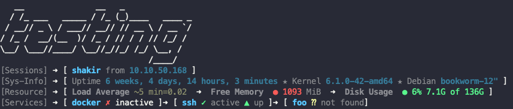
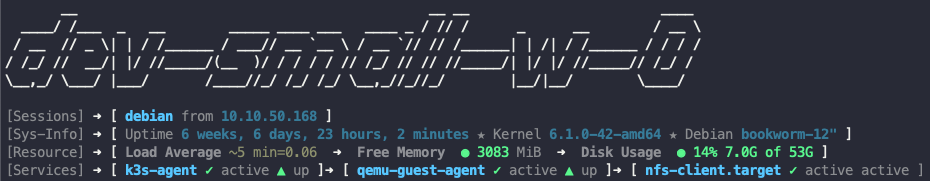

# Bash Login

A lightweight login banner for Bash that displays system information. It can be integrated  with `.bashrc` to display helpful messages in an elegant way for the services you want. Useful on remote servers.





Default display at login:
- system information
- user sessions

Optional items
- show systemd service status (by supplying service names as args)
- customizable banner style

Requires [Figlet](https://www.figlet.org). Usually installed by default on major Linux distros and MacOS.

> [!NOTE]
> Figlet only detects fonts installed locally, typically located in: `/usr/share/figlet/`. Install additional fonts via your package manager or manually add `.flf` files to that directory.

## Usage

Clone the repository:

```bash
git clone https://github.com/tinycloud-labs/bashlogin.git ~/.config/bashlogin
```

Add this line to your `~/.bashrc`:

```bash
source "$HOME/.config/bashlogin/main.sh"
```

Reload your shell:

```bash
source ~/.bashrc
```

### Ansible tasks

```yaml
- name: Clone bashlogin repo
  ansible.builtin.git:
    repo: "https://github.com/tinycloud-labs/bashlogin.git"
    dest: "{{ default_user_home }}/.config/bashlogin"
    version: "main"
    update: true
    force: true
  ignore_errors: true
  register: common_bashlogin_clone

- name: Make main.sh executable
  ansible.builtin.file:
    path: "{{ default_user_home }}/.config/bashlogin/main.sh"
    mode: '0755'
  when: common_bashlogin_clone is succeeded or common_bashlogin_clone is skipped

- name: Add login info message
  # assuming you declared a variabe `common_bashlogin_args: "foo bar"` somewhere in common/*.yml
  ansible.builtin.blockinfile:
    block: |
      BASHLOGIN_ARGS={{ common_bashlogin_args | quote }}
      source "$HOME/.config/bashlogin/main.sh"
    path: "{{ default_user_home }}/.bashrc"
    marker: "## {mark} ANSIBLE MANAGED BLOCK ##"
  no_log: true
  when: common_bashlogin_clone is succeeded or common_bashlogin_clone is skipped
```

### Optional configuration
You can change the Figlet style and provide systemd service unit names to print.

In `~/.bashrc`, export `BASHLOGIN_ARGS`:
- Supply the service names (must be in systemd units)
- Optionally, use the `--style <FigletStyleName>` to change the Figlet style

> [!TIP]
> The `--style <arg>` is not a positional arg, it can be placed anywhere in the line

Example:
```bash
BASHLOGIN_ARGS="--style big ssh docker k3s-agent"
```
